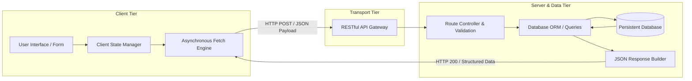

<div align="center">


[](https://developer.mozilla.org/en-US/docs/Web/HTML)
[](https://developer.mozilla.org/en-US/docs/Web/JavaScript)
[](#)
[](#)
[](#)

</div>

---

## 📌 Executive Summary / Overview

The **Full-Stack Web Engineering III Suite** (`FSD_PothamchettyJeswanthika3`) is the capstone development workspace for advanced full-stack integration at the Department of Computer Applications, Alliance University.

This module bridges client-side presentation with server-side computational services: executing asynchronous HTTP transactions (`fetch` / `async-await`), serializing structured JSON payloads, integrating RESTful API endpoints, handling network latency states, and modeling relational/NoSQL persistence schemas.

---

## 📖 Interactive Table of Contents

- [Executive Summary / Overview](#-executive-summary--overview)
- [Key Features & Capabilities](#-key-features--capabilities)
- [System Architecture & Full-Stack Data Pipeline](#-system-architecture--full-stack-data-pipeline)
- [Tech Stack Breakdown](#-tech-stack-breakdown)
- [Full-Stack Integration Architecture](#-full-stack-integration-architecture)
- [Reproducible Quickstart & Setup](#-reproducible-quickstart--setup)
- [Project Directory Layout](#-project-directory-layout)
- [Author & Contributions](#-author--contributions)

---

## ✨ Key Features & Capabilities

- **Asynchronous HTTP Communication**: Leverages JavaScript Promise semantics (`async/await`) and the Fetch API to execute non-blocking network calls.
- **RESTful Endpoint Interfacing**: Consumes and processes standard HTTP verbs (`GET`, `POST`, `PUT`, `DELETE`) with structured status code validation (`200 OK`, `404 Not Found`, `500 Server Error`).
- **Dynamic State Serialization**: Encodes client-side form payloads into JSON objects for transport over network boundaries.
- **Resilient Error & Loading States**: Implements defensive UI loading indicators, timeout fallbacks, and error boundaries for interrupted network conditions.
- **Database Persistence Modeling**: Explores relational schema design, table normalization, and primary/foreign key relational integrity.

---

## 🏗️ System Architecture & Full-Stack Data Pipeline



---

## 🛠️ Tech Stack Breakdown

| Category | Technologies & Tools |
| :--- | :--- |
| **Frontend Technologies** | HTML5, Modern CSS3, Vanilla ES6+ JavaScript |
| **Network Protocols** | HTTP/1.1, HTTP/2, REST, JSON Serialization |
| **Asynchronous Engine** | JavaScript Promises, `async/await`, Fetch API |
| **Backend Integration** | Node.js / Express, Python Flask / FastAPI, Java Servlets |
| **Database Systems** | SQL (PostgreSQL / MySQL), MongoDB |

---

## 🔌 Full-Stack Integration Architecture

| Operation | HTTP Verb | Data Flow | Success Metric |
| :--- | :--- | :--- | :--- |
| **Fetch Catalog** | `GET` | Server $\to$ Client JSON stream | `200 OK`, Array hydrated |
| **Submit Record** | `POST` | Client Form $\to$ Server Entity Creation | `201 Created`, ID returned |
| **Modify Record** | `PUT` / `PATCH` | Updated Attributes $\to$ Server Mutation | `200 OK`, Entity updated |
| **Delete Record** | `DELETE` | Identifier Token $\to$ Server Deletion | `204 No Content` |

---

## 🚀 Reproducible Quickstart & Setup

### Prerequisites
- Modern web browser and Node.js or Python runtime for backend serving

### Step 1: Clone the Repository
```bash
git clone https://github.com/Jeshwanthika07/FSD_PothamchettyJeswanthika3.git
cd FSD_PothamchettyJeswanthika3
```

### Step 2: Open and Preview
```bash
# On Windows:
start index.html

# On Linux/macOS:
open index.html
```

---

## 📂 Project Directory Layout

```text
FSD_PothamchettyJeswanthika3/
│
├── README.md                  # Comprehensive full-stack architectural documentation
└── LICENSE                    # Open-source MIT license
```

---

## 👩‍💻 Author & Contributions

Authored by **[Jeshwanthika Pothamchetty](https://github.com/Jeshwanthika07)**  
*Department of Computer Applications, Alliance University*

<div align="center">


</div>
